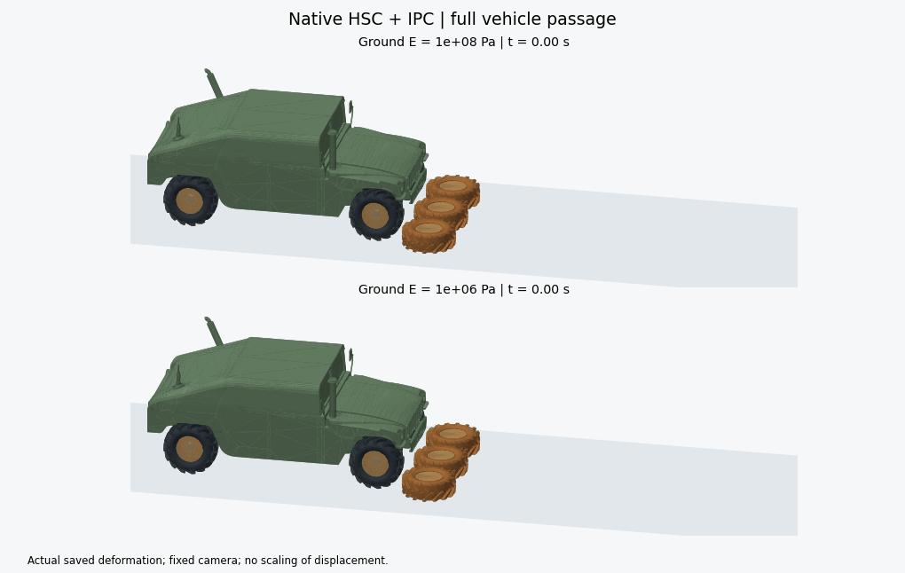

# HSC_reimpl

基于 HSC 论文方法的刚柔耦合车辆模拟。项目使用 Project Chrono 的 HMMWV 资产构建车辆，将碰撞、摩擦、悬挂、胎圈连接和轮胎弹性接入同一个 Newton/IPC 时间推进流程，由原生 HSC 求解每次线性系统。

仓库提供可运行的场景、后端构建脚本，以及两组汽车完整驶过轮胎的结果。两组车载轮胎的杨氏模量均为 `1e10 Pa`，地面轮胎分别为 `1e8 Pa` 和 `1e6 Pa`，用于观察地面胎刚度对变形和车辆行程的影响。



## 查看结果

| 指标 | 地面胎 E = 1e8 Pa | 地面胎 E = 1e6 Pa |
|---|---:|---:|
| 完成帧数 | 213 | 209 |
| 模拟时长 | 7.100 s | 6.967 s |
| 车身前移 | 6.254 m | 6.132 m |
| 结束时车尾与障碍的间距 | 0.296 m | 0.282 m |
| 地面胎峰值节点位移（轮辋坐标系） | 13.544 mm | 246.637 mm |
| HSC 线性求解次数 | 6,161 | 6,402 |

两组均达到 `COMPLETED_FULL_PASS`：四个车轮越过对应障碍，整车越过全部障碍至少 0.15 m，并保持五帧。场景包含 12 个仿射体（ABD）、7 个有限元胎体（FEM），共 78,197 个 Tet4 单元。

[结果报告](result/vehicle_full_pass/report.md)提供变形曲线、求解记录和论文参数对应关系；[CSV 对照表](result/vehicle_full_pass/comparison.csv)可用于后续分析。每组结果还附有逐帧轨迹、网格快照、运行参数和源码哈希。

## 开始使用

```powershell
git clone https://github.com/Powein/HSC_reimpl.git
cd HSC_reimpl
```

报告、图片和动画可直接打开。重新绘图时，使用 Windows PowerShell 和 Python 3.12，在仓库根目录执行：

```powershell
./reproduction/setup.ps1 -Python python
python reproduction/experiments/vehicle_full_pass/render.py --animate
```

运行物理实验需要构建带 HSC 补丁的 libuipc CUDA 后端。按[安装与运行指南](REPOSITORY.md)准备环境、编译后端，再复制实验配置到新的结果目录，即可运行两组刚度实验。默认配置对应仓库中已完成的结果。

## 项目内容

| 模块 | 提供的内容 |
|---|---|
| [完整行程实验](reproduction/experiments/vehicle_full_pass/README.md) | 两组刚度配置、运行入口、完成判据、断点恢复、统计与绘图 |
| [HSC 后端](reproduction/hsc_backend/README.md) | ACA、Schur PCG、Neumann 预条件、原生求解日志和 Windows 构建脚本 |
| [轮胎材料与体积约束](reproduction/hsc_backend/NONINVERSION.md) | 对数 Neo-Hookean 本构、CUDA 导数和整条线搜索路径的单元体积检查 |
| [车辆装配](reproduction/vehicle_assembly/README.md) | 闭合碰撞代理、四套悬挂、车轮转动关节和 FEM–ABD 胎圈连接 |
| [资产目录](reproduction/vehicle_research/README.md) | Chrono 车辆与轮胎资产、Tet4 转换、来源清单和接触实现索引 |
| [核心算法参考](reproduction/README.md) | NumPy HSC 实现、合成矩阵实验和作者 CUDA 函数检查 |
| [作者代码](Guo-2026-HSC/README.md) | 作者发布的 CUDA 头文件、说明和许可证，共 34 个文件 |

实验代码位于 `reproduction/experiments/<实验名>/`，结果位于 `result/<实验名>/`。组件级实验随各模块保存在 `results/` 中。论文和技术附录见[作者项目页](https://sites.google.com/view/multibody)，开源代码与资产的版本、许可证见[第三方来源说明](reproduction/vehicle_research/THIRD_PARTY_NOTICES.md)。
