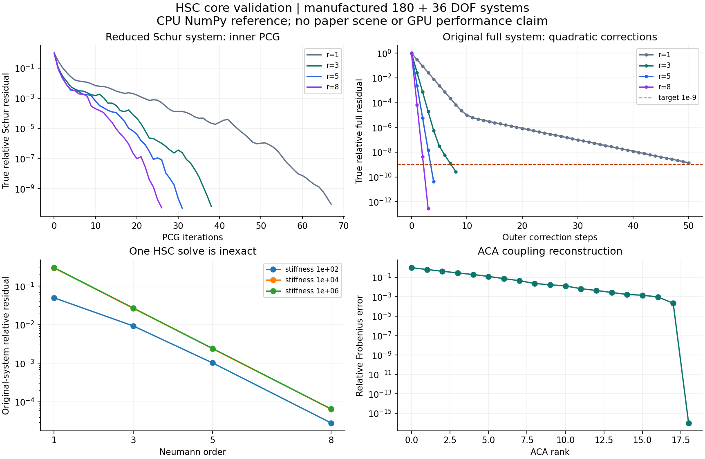

# HSC 核心算法参考

本目录提供可独立阅读的 NumPy HSC 实现、合成矩阵实验，以及作者 CUDA 函数的 GPU 数值检查。车辆时间推进使用 [HSC 原生后端](hsc_backend/README.md)，完整行程及两组轮胎刚度结果见 [vehicle_full_pass](experiments/vehicle_full_pass/README.md)。

## 算法与实验

| 内容 | 实现 |
|---|---|
| 分块线性系统与 Schur 补 | 按论文公式 (2)、(3) 构造，与独立直接解对照 |
| 全主元 ACA | 固定最大秩，采用数值零主元保护 |
| Neumann 逆近似 | 使用完整 3×3 FEM 块逆和 12×12 ABD 块逆 |
| Schur PCG | 对 Schur 算子迭代，以 FEM 块的 Neumann 算子预条件 |
| 外层误差校正 | 在合成二次能量上使用解析步长，记录原系统残差和解误差 |
| 作者 CUDA 函数 | 提取原函数体，经 NVRTC 编译后执行解析式和有限差分核对 |

主实验使用 `ω=0.7`、五项 Neumann、180 个 FEM 自由度和 36 个 ABD 自由度。矩阵由 `manufactured_system` 构造为对称正定系统，保存输入矩阵、右端、已知解和独立直接解。原系统残差按原始矩阵 H 计算。

## 查看结果

| 检查 | 已保存结果 |
|---|---|
| CPU 数值检查 | 13/13 通过 |
| CUDA 函数检查 | 12 类，每类 20 个固定种子样本，全部通过 |
| GPU | NVIDIA GeForce RTX 3060 Ti，compute capability 8.6，8 GB |
| ACA 精确低秩重建 | 相对误差约 1e-16 |
| 精确 Schur 对照与独立直接解 | 解的相对误差 6.10e-13 |
| GPU 函数与解析式 | 最大绝对误差 2.14e-14 |
| GPU 导数与有限差分 | 最大绝对误差 8.34e-10 |

五项 Neumann 下，三个合成系统的结果如下：

| 构造刚度尺度 | 单次 HSC 原系统相对残差 | 外层校正次数 | 校正后原系统相对残差 | 相对直接解误差 |
|---:|---:|---:|---:|---:|
| 1e2 | 1.025e-3 | 6 | 8.708e-11 | 2.234e-9 |
| 1e4 | 2.388e-3 | 5 | 8.762e-11 | 8.565e-9 |
| 1e6 | 2.430e-3 | 4 | 4.103e-11 | 1.198e-7 |

最后一个系统的条件数约为 `4.23e5`，因此同时记录残差和解误差，以观察条件数对解精度的影响。主实验的 ACA 最大秩为 36，实际在秩 18 触及数值零主元保护。

刚度尺度 `1e6` 的秩消融中，秩上限 4、8、12、18 分别需要 45、10、5、4 次外层校正。Neumann 项数消融使用 50 次校正预算和 `1e-9` 残差目标：三项、五项、八项达到目标，一项运行至预算上限。完整曲线与收敛状态保存在 [experiments.json](results/experiments.json)。



CUDA 检查覆盖仿射投影、梯度与 Hessian，`rotational_*` 能量及导数，3×3/12×12 稀疏矩阵乘法，以及对角块乘加。作者代码中的 `rotational_energy` 定义为两个仿射点之间的二次距离，检查按这一函数定义进行。每个提取函数的 SHA-256 与误差记录在 [gpu_checks.json](results/gpu_checks.json)。

## 运行核心实验

使用 Windows PowerShell 和 Python 3.12。核心入口同时执行原始资料校验：先从[作者项目页](https://sites.google.com/view/multibody)获取论文正文和源码包，分别保存为仓库根目录的 `HC.pdf`、`Guo-2026-HSC.zip`。已保存记录对应的源码包 SHA-256 为 `ec833f3d707233b9d3efb9c5e979b10e7ef6a2dcdb6e7835a8658cb30b0e455b`，下载来源见 [provenance.json](downloads/provenance.json)。

在仓库根目录执行：

```powershell
./reproduction/setup.ps1 -Python python
./reproduction/run.ps1 -Python python
```

CPU 算法实验可单独运行：

```powershell
./reproduction/run.ps1 -Python python -SkipGpu
```

依赖按 [requirements-lock.txt](requirements-lock.txt) 安装到 `reproduction/_deps/`。GPU 函数检查使用其中的 NVRTC 12.9 包与 NVIDIA 驱动。运行入口保存 stdout、stderr 和退出状态，默认时限 600 秒，可用 `-TimeoutSeconds` 调整。输出写入 `reproduction/results/`。

## 文件索引

| 文件 | 用途 |
|---|---|
| [core.py](core.py) | CPU 算法参考、块逆、ACA、PCG 和合成系统构造 |
| [cuda_original.py](cuda_original.py) | 原函数提取、NVRTC 编译、GPU 调用与数值检查 |
| `run.py` / `run.ps1` | 实验运行与日志 |
| [paper_parameters.json](paper_parameters.json) | 论文及附录参数和出处 |
| [numerical_checks.json](results/numerical_checks.json) | 13 项 CPU 数值检查 |
| [gpu_checks.json](results/gpu_checks.json) | GPU 误差、阈值、设备与函数哈希 |
| [experiments.json](results/experiments.json) / [summary.csv](results/summary.csv) | 刚度、阶数、秩消融与残差曲线 |
| `results/fixture_*.npz` | 输入矩阵、右端及参考解 |
| [core_validation.svg](results/core_validation.svg) | 可缩放的数值结果图 |
| [source_audit.json](results/source_audit.json) / [environment.json](results/environment.json) | 原始文件核对与运行环境 |
| `results/status.json` / `run.log` / `stderr.log` | 运行状态和日志 |

作者发布包的 34 个文件保存在 `Guo-2026-HSC/`。本目录按论文方程提供参考算法，原生后端将同类分块方法用于车辆的实际 Newton 系统。车辆资产、连接及接触参数分别见[资产目录](vehicle_research/README.md)、[车辆装配](vehicle_assembly/README.md)和[后端说明](hsc_backend/README.md)。
