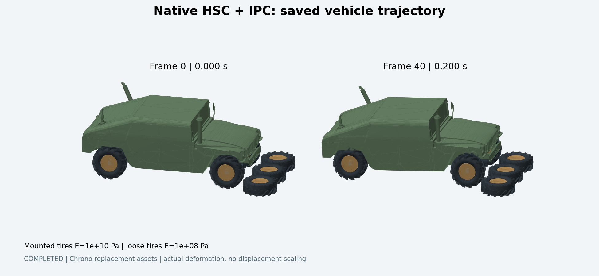

# 车辆 IPC ↔ HSC 原生接入

本轮两档地面胎刚度的完整行程均已完成，分别为 213、209 帧；见[结果报告](../../result/vehicle_full_pass/report.md)。入口为 [vehicle_full_pass](../experiments/vehicle_full_pass/README.md)，数据位于项目根目录 `result/vehicle_full_pass/`。本页下述 40 帧结果是接入阶段的历史记录。

完整行程已新增对数 Neo-Hookean 与四面体路径检查，解决软胎局部翻转；见[防翻转实现与来源](NONINVERSION.md)。原生 HSC 保持不变，旧短测仍使用其原始材料设置。

**接入阶段记录：40 帧（0.200 s）。** 碰撞、摩擦、胎圈和悬挂共同装配的矩阵已交给 HSC，车辆驶入散落轮胎并产生接触响应。
该阶段使用自适应 ABD Neumann 延长和混合 CPU/GPU 实现，资产为论文场景的替代装配。这段轨迹只覆盖接触初期，未包含整车通过，也未复现作者的性能数据。
不能把此前 `vehicle_assembly/results/` 中默认 PCG 的结果当作 HSC 结果。

## 接入阶段实际结果

[运行状态](results/paper_contact_adaptive_40/status.json)、[逐次 HSC 记录](results/paper_contact_adaptive_40/hsc_stats.jsonl)、[运行日志](results/paper_contact_adaptive_40/run.log)。

| 项目 | 实际记录 |
|---|---:|
| 场景 | 12 ABD，7 FEM 轮胎（4 安装胎 + 3 散落胎） |
| FEM / ABD 自由度 | 74,508 / 144 |
| 安装胎 / 散落胎杨氏模量 | 1e10 / 1e8 Pa |
| 完成时间步 | 40 × 0.005 s |
| HSC 调用 / 其他求解器回退 | 601 / 0 |
| 最大 Schur 相对残差 | 9.9983e-5 |
| 最大原始完整系统相对残差 | 9.8111e-5 |
| 最早激活网格接触的帧 | 22 |
| 最大激活网格 / 地面接触数量 | 35 / 177 |
| 车身 X 位移 | 0.114381 m |
| 两侧散落轮辋 X 位移 | 0.039649 / 0.042918 m |
| ACA 实际秩 | 84（上限 128） |
| ABD Neumann 倍增次数 | 17–20（从五项开始） |
| 单次 Schur PCG 最大迭代数 | 1,059 |
| 每帧最大 Newton 次数 | 23（上限 200） |
| 保存状态中的最小四面体体积比 | 0.916385 |
| 保存状态中的最大胎圈距离误差 | 1.2340e-5 m |
| 运行耗时 | 425.41 s；不是论文性能对照 |

进程退出码 0；运行日志只有接触刚度自动夹取提示，未出现 Newton/线搜索达上限或 native error。
实际接触刚度被 libuipc 调整为约 4.678e11。轨迹为驶入接触的短段，不能称为整车碾过全部轮胎。
这里只读取本次运行生成的状态和求解记录，没有重跑此前装配验证套件。



[保存状态动画](results/paper_contact_adaptive_40/preview/trajectory.gif)。所有变形来自求解后的几何，没有位移放大。

## 接入位置

固定 libuipc 提交：`9c748a759bb9952a7aeedd59076a70591dc61d6c`。
`integration.patch` 可直接审阅改动，`linear_hsc.cu` 是新增的原生求解器。

车辆代理网格、体积轮胎、胎圈 `SoftVertexStitch`、悬挂和转动关节继续由
`vehicle_assembly/scene.py` 构建。libuipc 的 IPC、摩擦、弹性和约束项首先统一
装配全局 Hessian；随后 `linear_hsc` 接收这一矩阵及右端项，返回更新方向。
既有 Newton、CCD 步长限制、线搜索和状态回写均在原后端中继续执行。

自由度区间来自 `ABDLinearSubsystem` 和 `FEMLinearSubsystem` 的实际 offset/count，
不假定论文源码与 libuipc 使用相同的仿射坐标排列。上游 `ge2sym()` 之后只保存
一个三角的 3×3 块；接入层恢复 ABD 矩阵及刚柔耦合时显式补转置，避免重复计数。

## 求解过程及界限

按 `HC.pdf` 第 3 节与补充材料 Algorithm 1 实现：

1. 从每次 Newton 的矩阵提取 ABD 块 A 和刚柔耦合 E，只收集 E 的非零接口列。
2. 全主元 ACA，固定最大秩，得到 E ≈ U Vᵀ。精确零秩用机器精度保护处理。
3. 用 12×12 块 Jacobi、ω=0.7、五项 Neumann 级数初始化 A⁻¹ 近似。
   默认自适应延长 ABD 多项式，见下一节；FEM 预条件仍保持五项。
4. 在 GPU 上求解 S Δx = bₓ − V Uᵀ P bq，其中 S = D − V(Uᵀ P U)Vᵀ。
   FEM 预条件器使用 3×3 块 Jacobi、相同五项 Neumann 级数。
5. 回代 Δq = P(bq − U Vᵀ Δx)，将完整方向交回 libuipc。

PCG 使用未平方相对 Schur 残差 `1e-4`。每次求解记录激活的网格/地面接触数量、ACA 误差、秩、
Schur 残差、原始完整系统残差、耗时和 `fallback:false`；不收敛或非下降方向会
显式失败，没有静默回退到 PCG 的路径。完整系统残差一般不会等于 Schur 残差，
因为 ACA 和 A⁻¹ 都是近似；原始系统残差会单独保留。
原始系统相对残差还必须不大于 0.1，避免把不准确的方向交给 Newton 的小步长终止条件。

### 固定五项与实际车辆的强关节耦合

首次实际运行 `results/paper_contact_40/` 使用论文固定五项 Neumann。Schur 残差
已达到 1e-4，完整系统残差却约为 0.998，表明车身、主轴、轮辋之间很硬的
关节约束所形成的整体运动模态没有被 ABD 逆近似解析出来。该运行主动停止，
状态为 `STOPPED_INACCURATE_ABD_INVERSE`，不作为成功的车辆结果。

默认实现现在用 `P₂ᵣ = Pᵣ + Pᵣ(I − A Pᵣ)` 按倍增方式延长 ABD Neumann
多项式，直到 `||I − A P||F / sqrt(n_ABD) <= 1e-5`，最多 48 次倍增。
这里 `n_ABD` 是 ABD 自由度数量。记录每次求解的倍增次数和逆残差。
没有切换到其他全局求解器，也没有改动物理材料或关节刚度。

**自适应延长是本地稳健性扩展，与论文固定五项设置存在差异。**
`run.ps1 -FixedNeumann` / `run_vehicle.py --fixed-neumann` 保留固定五项路径，
但同样受完整系统残差限制；这个车辆配置会显式报告近似精度不足。
不能把自适应版本的耗时当作论文固定五项算法的性能复现。

**这是混合 CPU/GPU 接入版本**：较小的 ABD/ACA 初始化采用 CPU Eigen，
大规模稀疏乘法、FEM 预条件和 Schur PCG 在 CUDA 上执行。没有宣称它复现了
作者全 GPU 实现的性能。作者下载包不包含完整可链接的模拟器，本文件是按论文
方程新实现的适配器；原始作者源码仍保留在 `Guo-2026-HSC/`。

固定 ACA 秩上限默认 128 是本地参数，论文未公开汽车场景的 k_max。
目前场景仍是 Chrono HMMWV 和公开轮胎网格构造的替代场景，胎圈、代理和悬挂
沿用前一阶段定义；不把它称为作者原始场景。

## 构建与运行

构建在 `build_location.json` 指向的独立目录中进行。本机因 C 盘空间不足迁至
`E:\HC-HSC-build-jaq6yw9h`。只使用独立 venv、官方 CUDA redistributable、
官方 Windows SDK NuGet 和固定版本 vcpkg 配方；不改系统注册表或默认 pyuipc。
TBB 保留核心线程库，关闭可选 hwloc 拓扑绑定。JSON 依赖使用作者发布的同版本
精简包，并按作者公布的 SHA256 检查；oneTBB 使用迁移后的官方地址，内容 SHA512
仍与固定 vcpkg 配方一致。

准备和构建脚本顺序：

```powershell
python prepare_build.py
python prepare_sdk.py
python prepare_dependencies.py
python build_backend.py --jobs 4
```

成功构建才写入 `runtime.json`。使用项目入口启动实际车辆模拟：

```powershell
& 'C:\Users\Powei\Desktop\复现HC\reproduction\hsc_backend\run.ps1' -Steps 40 -Obstacles 3 -MotorSpeed 2 -StartX -2.6
```

默认使用 `paper_stiffness`：安装胎 E=1e10 Pa，地面胎 E=1e8 Pa。
扩展为 12 胎障碍配置：

```powershell
& 'C:\Users\Powei\Desktop\复现HC\reproduction\hsc_backend\run.ps1' -Steps 300 -Obstacles 12 -Profile paper_stiffness -MotorSpeed 2 -StartX -2.6 -Rank 256
```

12 胎示例把 ACA 上限提高到 256，以容纳更多独立轮辋的胎圈耦合。
上面是运行参数，并不代表已经完成对应轨迹。`results/<label>/status.json`
记录实际完成帧数；`hsc_stats.jsonl` 证明原生求解器调用；`snapshots.npz`
保存几何状态。新的运行入口推进场景，不重跑此前胎圈、悬挂与接触的验证套件。
`python render_trajectory.py results/<label>` 可从已保存状态生成 PNG 和 GIF，
不会再次启动物理求解。

## 一手来源

- [论文项目页](https://sites.google.com/view/multibody)，本地 `HC.pdf` 与补充材料。
- [libuipc 固定源码](https://github.com/spiriMirror/libuipc/tree/9c748a759bb9952a7aeedd59076a70591dc61d6c)，Apache-2.0。
- [官方 Windows 构建说明](https://spirimirror.github.io/libuipc-doc/build_install/windows/)。
- [NVIDIA CUDA 12.8.1 redistributable 清单](https://developer.download.nvidia.com/compute/cuda/redist/redistrib_12.8.1.json)，下载包按官方 SHA256 核验。
- [Microsoft Windows SDK C++ NuGet](https://www.nuget.org/packages/Microsoft.Windows.SDK.CPP/10.0.26100.3916)，本地构建依赖。

车辆与轮胎来源和许可详见 `../vehicle_assembly/README.md` 和 `../vehicle_research/` 中的下载记录。
