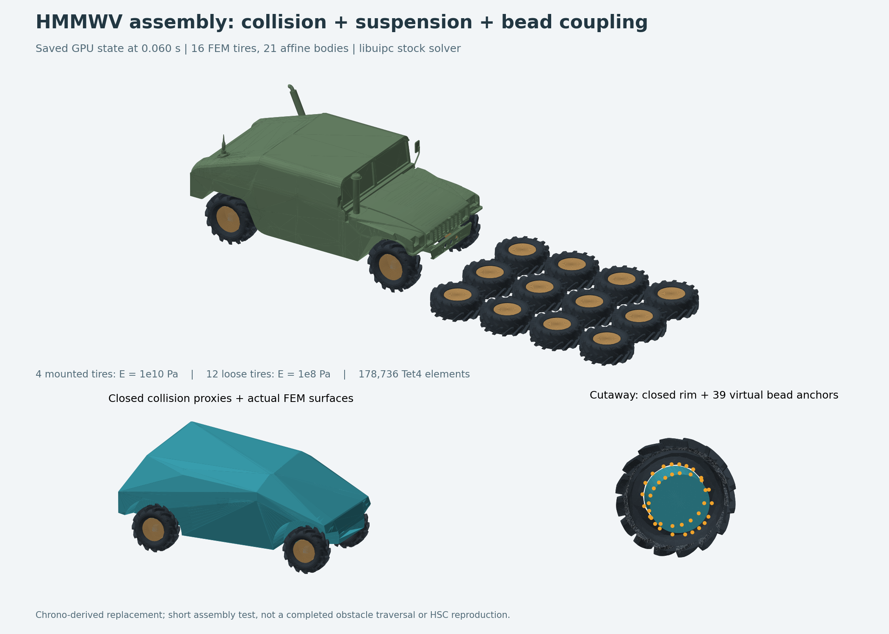
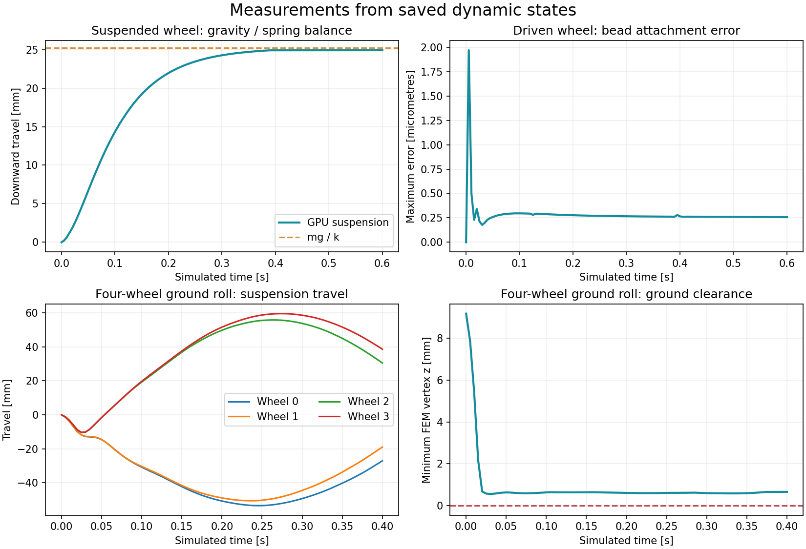
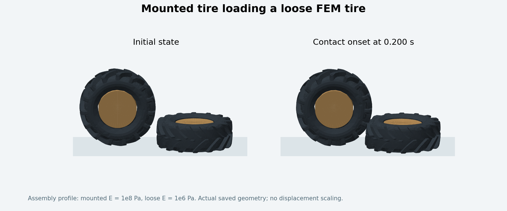

# 汽车场景：碰撞代理、悬挂和胎圈连接

本轮完整行程和两档地面胎刚度对照均已完成，见[结果报告](../../result/vehicle_full_pass/report.md)和 [vehicle_full_pass 入口](../experiments/vehicle_full_pass/README.md)，采用原生 HSC、`dt=1/30 s` 和独立的根目录 `result/` 输出。本页参数表与动态验证表保留早期装配短测的设置，供追溯。

2026-10-17。三个部件已接入可运行的 GPU 装配，使用 Project Chrono 的 HMMWV 资产和 libuipc 的刚柔耦合接口。源码入口是 [scene.py](scene.py)，测量汇总是 [verification.json](verification.json)。原始 HSC 代码包没有改动。



这是 **Chrono 资产衍生的替代装配**。论文补充材料描述轮毂、轮辐与轮胎通过接触传递运动；本次按任务要求加入了明确的胎圈绑定。这种绑定参考 Chrono 的轮辋连接方式，不能称为论文原场景的逐项复刻。本页下述历史验证使用 libuipc 自带线性求解器；后续已将同一装配的 IPC、约束和弹性矩阵接入 [原生 HSC](../hsc_backend/README.md)。新的 HSC 结果与本页历史数据分别保存，原有入口仍可运行。

## 实现内容

| 部件 | 实现 | 复用来源与局限 |
|---|---|---|
| 车身碰撞/质量代理 | Chrono 原碰撞网格的闭合凸包，切除四个轮罩；283 顶点、562 三角形 | 使用 Trimesh + Manifold；保留外形尺度，但填平了车窗、底盘凹陷等细节，惯量来自代理体积积分 |
| 轮辋/轮毂代理 | 沿 Y 轴的闭合圆柱，98 顶点、192 三角形，半径 0.23543 m | 代理半径按线性轮胎孔洞的边段距离计算，预留 6 mm 径向间隙；不包含论文的详细轮辐 |
| 主轴/滑块代理 | 0.10 × 0.12 × 0.12 m 闭合盒体 | 滑块与主轴共用一个 ABD，作为简化机构 |
| 四套独立悬挂 | 车身—主轴滑动关节 + 弹簧 + 沿轴阻尼 + 行程限位 | libuipc 原生 PrismaticJoint、ExternalForce、JointLimit；不是 Chrono 完整双叉臂机构 |
| 轮毂转动 | 主轴—轮毂转动关节，可选角速度驱动 | libuipc RevoluteJoint / DrivingRevoluteJoint；通过关节反力驱动车身，未直接平移车身 |
| 胎圈连接 | 每个轮胎两圈共 39 个 `BC_CONN` 角节点，连接到轮辋的同位置虚拟锚点 | Chrono 节点集 + libuipc SoftVertexStitch；零原长、每点 1e8 N/m 的有限刚度约束 |
| 胎体与接触 | 每胎 3,548 顶点、11,171 Tet4；早期短测使用 Stable Neo-Hookean；IPC + CCD + 摩擦 | 完整行程改用对数 Neo-Hookean 和单元路径检查；未添加空气内压、帘线或各向异性材料 |

所有四种输出代理均通过闭合性、法向一致性、正体积和非退化三角形检查。代理与参数记录见 [assets/proxy_audit.json](assets/proxy_audit.json)，生成过程见 [build_proxies.py](build_proxies.py)。

CoACD 1.0.14 的自动凸分解在本机 240 秒限额内没有完成，未把它写成成功结果。默认路径现为确定性的凸包加轮罩布尔切除。原始输入存在开边和非流形边；保留 `--coacd` 实验路径及 `logs/build_proxies.*`，方便后续改进几何质量。

### 连接与碰撞的关系

机构关系为：`车身 ABD → 滑动关节/弹簧/阻尼 → 主轴 ABD → 转动关节 → 轮辋 ABD → 胎圈约束 → FEM 胎体`。

胎圈能量为 `E = 0.5 × kb × ||x_tire − (A_rim X_anchor + p_rim)||²`。锚点随轮辋的 ABD 变换运动，参与求解器的刚柔交叉项；不是每帧覆盖胎圈位置。悬挂弹簧使用同一原生接口的非零原长形式 `E = 0.5 × ks × (L − L0)²`。阻尼通过上一帧关节位移差估算速度，施加 `F = −c v`，因此是显式更新的阻尼力，稳定性依赖时间步和参数。

只排除有意重叠的“车身—所属滑块”和“主轴—所属轮毂”碰撞。虚拟锚点没有表面和质量贡献，并单独禁用接触，避免相合锚点产生零距离 IPC 奇点。**实体轮辋—胎体、胎体—胎体、胎体自接触、地面接触仍保留**。完整排除表随每次运行保存在 `scene_manifest.json`。

第一次轮辋检查发现：仅用孔洞顶点半径会高估线性三角面的可用孔径，导致初始化相交。现在按投影边段的最小径向距离生成代理；修正后的装配通过 libuipc 初始化碰撞检查。该检查与运行中的 CCD 来自库实现，我们尚未用第二个独立碰撞引擎逐对复核全部连续轨迹。

## 参数及出处

| 参数 | 当前值 | 性质 |
|---|---:|---|
| 时间步 / 重力 / 摩擦系数 | 0.005 s / 9.8 m/s² / 0.6 | 本地验证选择 |
| `paper_stiffness` 的安装胎 / 地面胎 E | 1e10 / 1e8 Pa | 对应 HC Fig.19 的两档杨氏模量；其余参数不因此成为论文参数 |
| `assembly` 的安装胎 / 地面胎 E | 1e8 / 1e6 Pa | 降低刚度的装配验证档，方便观察变形 |
| 泊松比 / 胎体密度 | 0.3 / 1000 kg/m³ | 本地假设；单胎约 63.8095 kg |
| 车身 / 轮辋质量 | 2086.52 / 18.8 kg | Chrono HMMWV JSON |
| 每个合并主轴质量 | 34.155 kg | Chrono spindle 14.705 + upright 19.45；未计入完整叉臂系统 |
| 悬挂等效刚度 | 45,374.0375 N/m | Chrono 前悬弹簧曲线近零斜率 181,496.15，乘本地假设运动比 0.5 的平方 |
| 悬挂等效阻尼 | 4,753.8923 N·s/m | Chrono 前悬阻尼 19,015.5692，乘相同运动比平方；四轮统一用这组简化值 |
| 悬挂行程 / 初始弹簧长度 | ±0.15 / 0.35 m | 本地简化选择；限位是罚能量，不是绝对硬截断 |
| 整车弹簧原长 | 约 0.46266 m | 以每角承受车身四分之一重力设置预压；不是 Chrono 原弹簧的自由长度 |
| 接触激活距离 | 1 mm | 本地 IPC 设置 |

悬挂弹簧是约束能量中的隐式项；胎圈和关节都是有限刚度约束，允许小量数值漂移。ABD 质量匹配上表，重心/惯量由简化代理生成，没有强行套用与代理不一致的 Chrono 惯量。轮胎 C3D10 只保留四角节点转换成 Tet4，未保留二次精度。

接触刚度请求值为 1e10，但 libuipc 会按场景自动夹取到有效范围。例如四轮平地测试初始实际值约 6.891e11，16 胎短测约 5.579e11。相关 warning 是参数调整信息，已经记录在 `verification.json`；完成测试的日志没有未审查的其他 warning 或 native error。

## 已完成的动态验证

运行环境：Windows、Python 3.12、pyuipc 0.0.28、RTX 3060 Ti 8 GB。所有数字来自保存的模拟状态；不与论文性能作比较。

| 测试 | 实际时长 | 结果 |
|---|---:|---|
| 固定轮辋、真实 FEM 胎体受重力 | 40 步 / 0.20 s | 胎圈全程最大误差 0.278 μm；四面体体积均为正 |
| 单轮悬挂 + 轮毂驱动 | 120 步 / 0.60 s | 实转 0.480000 rad；胎圈最大误差 1.969 μm；下沉 24.916 mm |
| 四轮整车接地滚动 | 80 步 / 0.40 s | 车身前移 0.13084 m；胎圈最大误差 12.775 μm；最小轮胎离地间隙 0.559 mm |
| 四安装胎 + 十二地面胎，论文两档 E | 12 步 / 0.06 s | 21 ABD、16 FEM、178,736 Tet4；胎圈最大误差 11.044 μm；最小体积比 0.99824 |
| 靠近首排三个障碍胎，较软装配档 | 40 步 / 0.20 s | 车身前移 0.10681 m；两侧障碍轮胎压缩；胎圈最大误差 16.847 μm；最小体积比 0.44746，未翻转 |

单轮悬挂的重量为 1144.29 N，末帧弹簧力 1130.52 N，偏差 1.203%；解析静力伸长 `mg/k` 为 25.219 mm。四轮平地测试的滑动关节最大横向误差约 0.051 μm，转动关节锚点最大误差约 0.028 μm。全部已完成案例均满足胎圈误差 <0.5 mm、关节横向/锚点误差 <1 mm、正四面体体积及无轮胎穿地的检查。



[悬挂与轮胎转动动画](preview/suspension_test.gif) 使用真实快照；弹簧线条只是连接位置的可视化。完整曲线、每五步网格快照、配置和结果分别保存在 `results/<案例>/trajectory.json`、`snapshots.npz`、`scene_manifest.json`、`result.json`。

12 胎障碍场景短测时车辆尚未驶到障碍上，不能当作“完整碾过轮胎”验收。另一个较软的首排接触试验中，两侧障碍轮辋分别向前移动约 5.39 / 5.70 mm，胎体受压，前轮已接触障碍。`results/obstacle_entry/` 保存其完整 40 步结果。该试验最初计划 60 步，因接触后耗时增长，在约 258 秒时主动停止；日志另存为 `obstacle_entry_60_stopped.*`，随后独立完成 40 步运行，未把停止的试验当作成功。



对首排试验的 9 个保存时刻，另用独立四面体分离轴检测复核全部 21 对不同轮胎，共 189 次轮胎对检查、2,704 个候选四面体对，**正体积相交数为 0**（容差 1e-9 m，允许相切）。该几何检查先通过 6 个可解析的相交/相离/相切样例；结果见 `results/obstacle_entry/independent_overlap_check.json`。它只覆盖保存帧中的胎体间相交，不代替库的连续 CCD，也未覆盖同胎自接触或 ABD 表面。

完整穿越、极限行程冲击、长期稳定性、轮胎材料标定和 HSC 性能仍待验证。

## 运行

当前工作区依赖已经就位，PowerShell 直接执行：

```powershell
# 单轮悬挂和轮胎驱动：默认 120 步。
& 'C:\Users\Powei\Desktop\复现HC\reproduction\vehicle_assembly\run.ps1'

# 四轮平地滚动。
& 'C:\Users\Powei\Desktop\复现HC\reproduction\vehicle_assembly\run.ps1' -Case vehicle -Steps 80

# 论文两档刚度，完整 16 胎装配短测。
& 'C:\Users\Powei\Desktop\复现HC\reproduction\vehicle_assembly\run.ps1' -Case vehicle -Profile paper_stiffness -Obstacles 12 -Steps 12

# 靠近第一排障碍的接触初期验证，使用较软的装配档。
& 'C:\Users\Powei\Desktop\复现HC\reproduction\vehicle_assembly\run.ps1' -Case vehicle -Obstacles 3 -Steps 40 -MotorSpeed 2 -StartX -2.6
```

默认每次创建带时间戳的结果/日志名，硬超时 300 秒，可通过 `-TimeoutSeconds` 调整。支持 `-Python` 指定 Python 3.12；新环境先运行本目录 `setup.ps1`。该脚本只在项目目录安装依赖，不要求全局 CUDA Toolkit。中文目录加载问题沿用之前的 `probe_cuda.py`，将 native runtime 缓存到系统临时目录的 ASCII 路径。

`build_proxies.py` 重建代理；`validate_assembly.py` 构造并求解场景；`check_tire_overlap.py` 独立核对首排接触快照；`audit_results.py` 汇总已保存的五个验收案例；`render_results.py` 重绘预览。新的运行每 10 步保存 `*_partial` 快照，外部超时不会被误报为 PASS。原始资产仍依赖相邻的 `vehicle_research/`，不要只移动一个 `.py` 文件。PowerShell 入口另通过一帧实际启动检查。

可转交的 [vehicle_assembly_bundle.zip](../vehicle_assembly_bundle.zip) 包含代码、代理、原资产、许可证和模拟快照，省略 Python/CUDA 二进制依赖。包内附逐文件 SHA-256；解压后可用 `setup.ps1` 安装依赖。

## 查阅并复用的开源资料

| 一手来源 | 在本次工作中的用途 |
|---|---|
| [Project Chrono HMMWV](https://github.com/projectchrono/chrono/tree/c5651d36a204a12e5c349eda0b141f47551f9c36/data/vehicle/hmmwv) | 车身、实体胎、轮胎连接节点集、质量与悬挂曲线；BSD-3-Clause |
| [Chrono FEATire.cpp](https://github.com/projectchrono/chrono/blob/c5651d36a204a12e5c349eda0b141f47551f9c36/src/chrono_vehicle/wheeled_vehicle/tire/FEATire.cpp)、[轮胎模型文档](https://api.projectchrono.org/wheeled_tire.html) | 核对轮辋节点连接与有限元胎体；未用 handling tire 替代实体胎 |
| [libuipc SoftVertexStitch](https://spirimirror.github.io/libuipc-doc/specification/constitutions/soft_vertex_stitch/)、[官方 ABD–FEM 示例](https://github.com/spiriMirror/libuipc-samples/blob/a7ca63fb33a3d6964e28ef5d187e2c817d20b8f5/examples/22_soft_vertex_stitch/main.py) | 核对零原长胎圈约束和非零原长悬挂弹簧的能量与接口 |
| [滑动关节](https://spirimirror.github.io/libuipc-doc/specification/constitutions/affine_body_prismatic_joint/)、[轴向外力](https://spirimirror.github.io/libuipc-doc/specification/constitutions/affine_body_prismatic_joint_external_force/)、[行程限制](https://spirimirror.github.io/libuipc-doc/specification/constitutions/affine_body_prismatic_joint_limit/) | 核对自由度、位移坐标、限位与可更新的轴向力；位移符号另用实际几何测量验证 |
| [CoACD](https://github.com/SarahWeiii/CoACD) | 尝试开源凸分解；本机该次运行超时，未采用其未完成输出；MIT |
| [Manifold](https://github.com/elalish/manifold)、[Trimesh](https://trimesh.org/) | 闭合代理构造、轮罩布尔运算、几何核查；分别 Apache-2.0 / MIT |
| [MuJoCo 接触计算文档](https://mujoco.readthedocs.io/en/stable/computation/index.html#collision-detection) | 对照通用几何碰撞方案；本次仍选择可直接耦合实体 FEM 与 ABD 的 libuipc，没有额外集成 MuJoCo |

新增 13 份官方源码/规范快照保存在 `references/`，固定 commit 和 SHA-256 见 [references_manifest.json](references_manifest.json)。前一阶段的 54 份资产与源码也继续保留。源码快照的 commit 不等于 PyPI 二进制的已验证构建 commit，因此 API/物理行为以实际运行结果共同核对。

第三方许可证及上游 Python 子目录声明的差异继续按 [原始来源说明](../vehicle_research/THIRD_PARTY_NOTICES.md) 保留；本次依赖和引用源码的许可证副本在 `licenses/`，版本在 `environment.json`。没有把原资产或上游源码改成自有许可。
