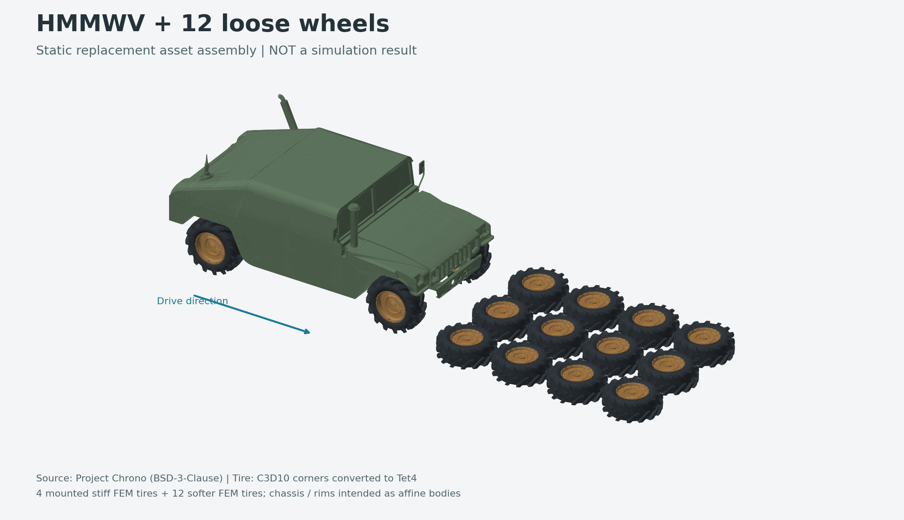

# HMMWV 碾过轮胎：资产与碰撞方案验收

后续更新：碰撞代理、悬挂和胎圈连接已在相邻工程实现并完成 GPU 动态短测，见 [装配实现与验证](../vehicle_assembly/README.md)。下面保留的是资产检索阶段的原始验收记录，其中“尚未装配”等描述指当时状态。

核查日期：2026-10-17。本轮目标是找到相同或可替代的场景资产，并确定碰撞处理方式。

| 验收项 | 结论 | 实际交付 |
|---|---|---|
| 论文原始完整场景 | **未找到公开下载** | 已核查作者项目页、原代码包、Stiff-GIPC、libuipc-samples、uipc-assets 公开目录；这不意味着互联网其他位置必然没有 |
| 相似场景资产 / 找不到后的替代方案 | **已找到并组装** | Project Chrono 的同车型 HMMWV + 4 个安装车轮 + 12 个平放车轮；OBJ、实体轮胎网格、配置和静态预览 |
| 碰撞处理方式 | **已明确，且本机小场景验证通过** | 推荐 libuipc 的 CUDA IPC + 连续碰撞检测 + 摩擦，统一处理 ABD/FEM 接触 |
| 完整汽车碾压动力学 / HSC 性能 | **尚未运行或验证** | 当前预览是静态资产组装；刚柔接触验证使用两个小方块及库内置求解器 |



## 1. 与论文场景的对应

用户提供的 `HC.pdf` 第 14 页 Fig. 19 展示 HMMWV 碾过平放的多材质车轮。图注明确每个车轮含轮辋、轮辐和可变形轮胎；安装在车上的轮胎使用 `E = 10^10 Pa`，地面车轮的轮胎使用 `E = 10^8 Pa`，其余部件采用 ABD。技术附录第 3 页 Fig. 3 给出四套独立悬挂、滑动关节、弹簧以及车轮转动关系。

已公开的 HSC ZIP 只有需集成的代码片段，缺少场景和完整碰撞流程。这里的“没有碰撞处理”特指该公开代码包缺失实现；**论文本身使用 IPC、CCD 和线搜索处理接触**。

当前替代场景使用同类车型，而非作者原始模型。车身外形、轮胎花纹、网格数量、地面轮胎位置均与原场景存在差别。12 个地面车轮的位置是本地选择的布局，不能当作作者初始条件。四个车轮的安装坐标参考 Chrono 的轴距与主轴偏移，悬挂尚未装配。

## 2. 找到并下载的可复用资产

主来源：[Project Chrono 的 HMMWV 目录](https://github.com/projectchrono/chrono/tree/c5651d36a204a12e5c349eda0b141f47551f9c36/data/vehicle/hmmwv)。仓库根许可证为 BSD-3-Clause，原文已随文件保留。模型参数 README 还列出了公开技术报告来源。

| 文件 | 实测内容 | 建议用途 |
|---|---|---|
| `hmmwv_chassis_simple.obj` | 7,678 顶点，15,330 三角形 | 车身显示网格；有开边/非流形边，不能直接假定适合质量积分及闭合碰撞 |
| `hmmwv_chassis_col.obj` | 880 顶点，1,685 三角形 | 现成碰撞外形参考，但检测到 35 条开边、39 条非流形边和 9 个退化面，仍需修补或换闭合代理 |
| `hmmwv_rim.obj` | 6,424 顶点，12,381 三角形，391 条开边 | 轮辋显示资产；下一阶段使用闭合轮辋/轮毂代理，避免把外观网格直接用于 ABD 质量计算 |
| `hmmwv_tire_coarse_closed.obj` | 306 顶点，612 三角形；边关联意义下闭合 | 低成本表面模型备选，不是现成实体有限元网格 |
| `tire/HMMWV_lugged_coarse.inp` | 21,359 节点，11,171 个 C3D10 四面体 | **首选可变形轮胎资产**；已转换成线性 Tet4 |
| 车辆、前后双叉臂悬挂、轮胎、车轮 JSON | 轴距、安装点、质量/惯量、悬挂曲线等 | 几何与工程参数参考；不是论文的参数，不直接套用 Chrono 的接触参数 |

原始资产位于 `upstream/projectchrono__chrono/`。本轮共保存 54 个精选资产/源码/许可证文件，约 5.74 MB；`download_manifest.json` 记录逐文件 URL、仓库 commit、字节数、SHA-256。上游原件保持不变。

### 已准备的实体网格和静态场景

- `prepared/tire_tet4.npz`：3,548 个顶点、11,171 个 Tet4、6,184 个边界三角形；同时保留原始节点编号及节点集合。
- `prepared/tire_tet4.msh`：Gmsh 2.2 ASCII 格式，便于其他模拟器读取。
- `prepared/tire_tet4_surface.obj`：从实体网格提取的表面。
- `prepared/vehicle_over_tires_static.obj`：整车 + 12 个平放车轮的静态装配。
- `prepared/scene_manifest.json`：坐标、旋转、单位、材质意图与尚未完成的连接。
- `prepared/asset_audit.json`：所有计数、开边/退化检查和尺度变换。

转换取 C3D10 的前四个角节点，**不保留二次形函数**，随后把轮轴由 X 转到 Y，并统一缩放到最大半径 0.47 m。全部线性四面体体积为正，最小原尺度体积约 `2.4573e-7 m³`；边界无开边、无非流形边、无零面积三角形。尚未执行该复杂轮胎网格的完整自相交检查。

原模型的 `BC_CONN` 是与轮辋连接的节点集，`BC_INT` 是内压表面相关节点集；已通过 Chrono 的 [`FEATire.cpp`](upstream/projectchrono__chrono/src/chrono_vehicle/wheeled_vehicle/tire/FEATire.cpp) 和 [`ChFEATire.cpp`](upstream/projectchrono__chrono/src/chrono_vehicle/wheeled_vehicle/tire/ChFEATire.cpp) 核实。转换后分别保留 39、291 个角节点。这为胎圈绑定提供了现成入口，但还需确认代理轮辋的对应关系；不能只依靠摩擦维持车轮连接。

16 个实体轮胎合计 **178,736 个四面体**。这比论文级模型小，适合先在本机 8 GB 显存上验证；尚未测量整车显存峰值或帧耗时。

## 3. 碰撞方案：复用 libuipc 的完整接触流程

首选 [libuipc](https://github.com/spiriMirror/libuipc)。它把 ABD 和 FEM 放进同一个接触/非线性求解流程，已经具有 GPU 碰撞检测、IPC 接触能量、摩擦、刚柔交叉 Hessian、滑动/转动关节。这样后续可以专门替换线性求解器，接入 HSC，而不必先重写整个碰撞系统。

| 环节 | 具体做法 | 已下载源码入口（`upstream/spiriMirror__libuipc/` 下） |
|---|---|---|
| 候选接触筛选 | 扫掠 AABB + BVH；更新当前状态与运动方向，筛选点–三角形、边–边及退化情形 | `src/backends/cuda/collision_detection/filters/stackless_bvh_simplex_trajectory_filter.cu` |
| 法向接触 | 距离接近阈值时加入 IPC barrier；计算梯度与 Hessian，并投影至半正定 | `src/backends/cuda/contact_system/contact_models/ipc_simplex_normal_contact.cu` |
| 防止一步穿过 | 使用加性 CCD / 保守推进计算安全步长上界；不能仅在步末检查是否重叠 | `src/backends/cuda/utils/distance/details/ccd.inl` |
| 切向摩擦 | 采用基于前一状态的正则化摩擦势，包含摩擦系数及滑动速度正则参数 | `src/backends/cuda/contact_system/contact_models/ipc_simplex_frictional_contact.cu` |
| 刚柔耦合 | 接触的空间梯度/Hessian 投影到 ABD 自由度；FEM 与 ABD 交叉块为 3×12 / 12×3 | `src/backends/cuda/coupling_system/abd_fem_linear_subsystem.cu` |
| 非线性步进 | 保留库的 Newton、CCD 安全步长与能量线搜索；监控非收敛和退化 | `src/backends/cuda/line_search/line_searcher.cu` 及引擎流程 |

对应到汽车：车身、轮毂/轮辋、悬挂硬部件采用 ABD，橡胶胎体采用 FEM，地面为静态平面。需要启用车轮–地面、车轮–地面轮胎、地面轮胎互相接触及可变形轮胎自接触；过滤共享顶点的邻接面和明确绑定的接触对。不能把整个轮胎的自碰撞或所有车内部件接触一概关闭。

对仿射顶点 `x = A X + p`，映射 Jacobian 在一次求解中是常量，可将接触项按 `g_q = Jᵀ g_x`、`H_q = Jᵀ H_x J` 装配。之后才形成 HSC 需要的 ABD、FEM 和耦合矩阵块。**HSC 是线性求解环节的替换，不取代 CCD、摩擦或线搜索。**

目前默认 `pyuipc` 轮子可用于接触基线；把现有 HSC 原型接入 GPU 后端需要 C++/CUDA 实现、构建与接口验证。建议入口为 `IterativeSolver::do_solve` 和 `GlobalLinearSystem::SolvingInfo`，并显式处理库内部 ABD 在前、FEM 在后的排序。不能把现在的 NumPy `core.py` 当成可直接热插拔的 GPU 求解器。

### 关节、胎圈与驱动

可复用示例已下载到 `upstream/spiriMirror__libuipc-samples/examples/`：

- `38_abd_prismatic_joint_driving_and_external_force`：滑动关节和外力。
- `39_abd_revolute_joint_driving_and_external_torque`：转动关节、目标角度和驱动扭矩。
- `20_contact_system_feature`：接触设置与检查接口。

按附录构建四套“车身支点 → 滑动件/轴 → 转动轮毂”的悬挂。轮胎通过胎圈节点约束到轮辋；`SoftVertexStitch` 提供零静长绑定及非零静长弹簧势，可作为连接/弹簧实现候选，仍需验证跨 ABD/FEM 对象的锚点映射及刚度单位。`HookeanSpring` 本身使用体积加权的杆件模量，不能把 N/m 弹簧常数直接填进它的材料模量。

使用车轮转动驱动/扭矩让车前进，而不是强制移动整车穿过障碍物。先验证单个轮胎与地面，再验证一个安装车轮压过一个地面轮胎，最后接入四轮悬挂；完整车场景稳定后再替换为 HSC。

### 其他开源选项

| 选项 | 可复用部分 | 本轮判断 |
|---|---|---|
| [Stiff-GIPC](https://github.com/KemengHuang/Stiff-GIPC) | GPU IPC、ACCD、摩擦、ABD/FEM 求解；论文也以它作为对照 | 适合贴近论文的底层实现参考，但公开场景中没找到 HMMWV；悬挂/整车仍需搭建，源码构建需要 CUDA Toolkit |
| [IPC Toolkit](https://github.com/ipc-sim/ipc-toolkit) | 距离、barrier、摩擦、CCD 等模块 | 适合独立对照验证；不是完整车辆模拟器，集成工作更多。当前源码也含 CUDA broad phase，不能简单称为纯 CPU 项目 |
| [Chrono HMMWV 示例](https://github.com/projectchrono/chrono/blob/c5651d36a204a12e5c349eda0b141f47551f9c36/src/demos/python/vehicle/demo_VEH_HMMWV.py) | 同车型、悬挂、车轮和车辆驱动组织 | 很好的资产/装配参考；其 FEATire 使用 Chrono 的 SMC 接触，不能当作论文的 IPC/HSC 求解流程 |

## 4. 本机已经做过的实际验证

系统：Windows；Python 3.12.14；RTX 3060 Ti 8 GB；驱动 616.92。

`pyuipc==0.0.28` Windows cp312 包已装到本目录 `_runtime/`。`doctor --probe-cuda` 确认：CUDA 12.8.93 运行时自带、原生 sm_86 代码可用、CUDA 后端加载并成功创建 Engine。本次运行不需要系统安装完整 CUDA Toolkit；后续编译修改后的 HSC 后端仍需要它。

直接从包含中文的工作区路径加载时，原生初始化报 `module_dir does not exist`；Windows 短路径仍含中文。`probe_cuda.py` 因此创建临时英文路径运行副本，成功绕过。日志保留了失败和成功情况，脚本会在临时目录被清理后重建副本。没有改动系统 Python。

小场景为 1 个 ABD 方块落在 1 个 FEM 方块上，下方为地面；每块 6 个四面体。采用库内置求解器，`dt=0.005 s`，120 步，共 0.6 s 模拟时间。

| 检查 | 实测 |
|---|---|
| 运行 | 120 步完成，约 8.14 s（含独立几何检查等，不是论文帧耗时） |
| 刚柔实体相交 | 每帧独立检查 36 对四面体，累计发现 0 对具有超过 1e-9 m 阈值的体积相交 |
| 地面穿透 | 所有帧 FEM 最低点均在地面上方，最小距离约 0.6604 mm |
| FEM 退化/翻转 | 最小有向单元体积约 `3.952e-3 m³`，始终为正 |
| 最后一步软体高度变化 | 压缩约 3.9515 mm |
| 摩擦 | 已启用，但未做定量摩擦验证 |
| 整车/HSC | 未运行；本测试不能外推成整车或 HSC 的正确性证书 |

接触系数输入为 `1e8`，引擎日志显示自适应机制将其夹到约 `2.146e11`；报告保留该行为，不能把输入值当作实际有效值。测试中的 FEM `E=1e5 Pa`、摩擦系数 0.4 等是小测试参数，**不是论文整车参数**。

第一次诊断用两个物体的竖直包围盒间距判断穿透，被倾斜/变形后的包围盒重叠误导；该记录保留为 `contact_probe_initial_aabb_diagnostic.*`。正式检查使用四面体完整分离轴集合，并已用重合、重叠、分离、恰好接触四个已知例子验证判据。正式数据位于 `prepared/contact_probe_result.json`。

## 5. 重建与后续边界

本工程已有所需 Python/绘图库。使用前一阶段配置的 Python 执行：

```powershell
$hcPython = 'C:\Users\Powei\.cache\codex-runtimes\codex-primary-runtime\dependencies\python\python.exe'
& $hcPython '.\reproduction\vehicle_research\prepare_assets.py'
& $hcPython '.\reproduction\vehicle_research\probe_cuda.py'
& $hcPython '.\reproduction\vehicle_research\contact_probe.py'
```

若迁移机器，先安装本工程绘图依赖，再用 `pip install --no-deps --target reproduction/vehicle_research/_runtime pyuipc==0.0.28` 安装 Windows 包；这里的路径处理脚本针对 Windows。`fetch_sources.py` 会按照清单固定 commit 获取精选原始文件，并对已有文件检查 SHA-256。

资产包 **不含一个声称能直接运行的完整汽车模拟器**：还缺闭合车身/轮辋/轮毂代理、四套悬挂与胎圈绑定、初始相交清理、材料/驱动校准及 HSC GPU 接入。已完成本轮“可用替代资产 + 明确接触方案”，完整 Fig. 19 数值复现仍待这些工作完成。

## 资料与版本

- HSC：用户原始 PDF/ZIP，作者[项目页](https://sites.google.com/view/multibody)及已下载技术附录。
- Chrono：`c5651d36a204a12e5c349eda0b141f47551f9c36`。
- libuipc 源码审查：`9c748a759bb9952a7aeedd59076a70591dc61d6c`；**实际执行的二进制为 PyPI 0.0.28，两者不声称逐字节对应**。
- libuipc-samples：`a7ca63fb33a3d6964e28ef5d187e2c817d20b8f5`。
- Stiff-GIPC：`bb2849a7b292099581907937860d96ecfdf42588`。
- IPC Toolkit：`4b3059c8539eed52fc9319c44756fa2136b88fa6`。
- uipc-assets：已检索 [Hugging Face 官方目录](https://huggingface.co/datasets/MuGdxy/uipc-assets)，快照 `82fb08d46f66a63428c91675b7a0eb261536ab61`，881 个文件，未发现汽车/轮胎场景。
- 许可证原文和上游声明差异见 `THIRD_PARTY_NOTICES.md`。没有向作者发邮件，也没有上传用户论文到外部模型。

Material Passport：academic-research-suite；模式为资产检索、源码核对与有界本地验证；单代理；结论分别标注静态资产、实际小场景结果和未验证内容。
