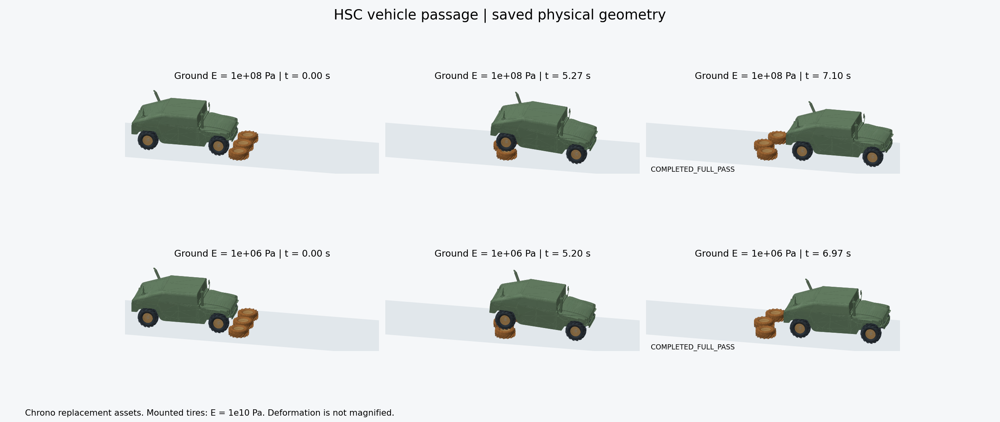
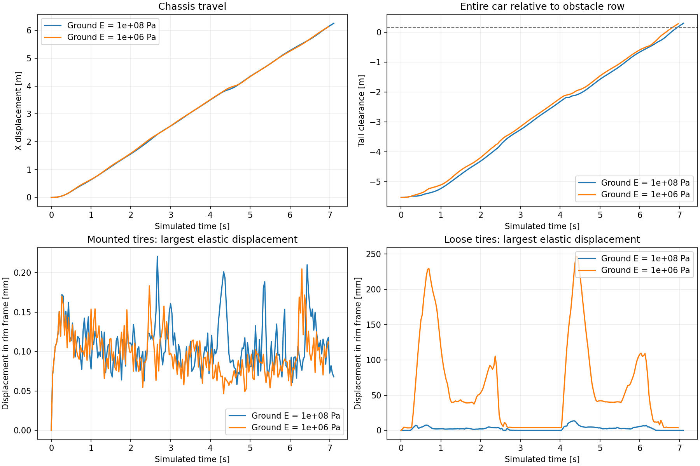

# 汽车完整越过轮胎：HSC 两组刚度实验

两组车辆均已完整通过一排三个地面轮胎，结束状态为 `COMPLETED_FULL_PASS`。四个车轮先后越过对应障碍，整车最后端越过全部障碍至少 0.15 m，并连续保持五帧。

实验固定车载胎 `E=1e10 Pa`，将地面胎分别设为 `E=1e8 Pa`、`E=1e6 Pa`。两组共用车辆、障碍布局、驱动、接触和 HSC 配置，用于比较地面胎刚度对变形与行程的影响。基准组的车载胎、地面胎杨氏模量对应论文 Fig.19；`1e6 Pa` 为项目增加的柔软对照，时间步均采用论文表 1 的 `1/30 s`。



[查看两组完整行程动画](preview/passage.gif)。图像按保存的 ABD 变换和 FEM 顶点绘制，采用固定相机和实际几何尺度，棕色表示地面轮胎。较早完成的一组在动画末段保持最终状态，画面标注各组实际模拟时间。

## 行程与胎体位移

| 指标 | 地面胎 1e8 Pa | 地面胎 1e6 Pa |
|---|---:|---:|
| 模拟时长（s） | 7.100 | 6.967 |
| 完成帧数 | 213 | 209 |
| 车身前移（m） | 6.254 | 6.132 |
| 结束时车尾与全部障碍的间距（m） | 0.296 | 0.282 |
| 地面胎峰值节点位移（mm） | 13.544 | 246.637 |
| 车载胎峰值节点位移（mm） | 0.221 | 0.205 |
| 最大胎圈连接误差（μm） | 29.115 | 62.377 |
| 最小四面体体积比 | 0.68947 | 0.16173 |
| 最低胎体顶点高度（mm） | 0.0219 | 0.0253 |
| 最大 ABD 正交误差平方 | 4.3714e-08 | 5.0163e-08 |

胎体位移在各自轮辋坐标系中计算：先用轮辋变换的逆将当前胎体节点映射回局部坐标，再求其相对初始节点位置的位移范数。表中取全部节点、全部帧的最大值。两组地面胎的峰值分别为 13.544 mm、246.637 mm，较软地面胎在通过过程中产生更大的相对位移。



四轮越过对应地面胎中心的时刻如下，单位为秒。越过时，轮心同时满足位于障碍横向范围内、高于障碍顶部两个条件。车尾间距的参照边界取全部障碍初始最前端与当前最前端的较大值，随障碍运动更新。

| 车轮位置 | 地面胎 1e8 Pa | 地面胎 1e6 Pa |
|---|---:|---:|
| 前轴 −Y 侧 | 1.567 | 1.533 |
| 前轴 +Y 侧 | 1.667 | 1.533 |
| 后轴 −Y 侧 | 5.300 | 5.233 |
| 后轴 +Y 侧 | 5.367 | 5.233 |

## HSC 求解记录

两组在实际 Newton/IPC 时间推进中使用原生 `linear_hsc`。碰撞、摩擦、悬挂、胎圈连接以及 FEM/ABD 弹性共同进入装配矩阵，HSC 采用 ACA、Schur PCG 和 Neumann 预条件。逐帧记录均满足完成与收敛条件，保存状态中的四面体体积比均为正。

| 指标 | 地面胎 1e8 Pa | 地面胎 1e6 Pa |
|---|---:|---:|
| HSC 线性求解次数 | 6161 | 6402 |
| 最大 Schur 相对残差 | 9.9999e-05 | 9.9999e-05 |
| 最大原始完整系统相对残差 | 9.8978e-05 | 9.9794e-05 |
| 单次 PCG 最大迭代数 | 2405 | 3062 |
| 每帧 Newton 最大迭代数 | 76 | 101 |
| 累计墙钟时间（s） | 19670.0 | 19444.6 |
| ACA 实际秩 | 84–96 | 84–96 |
| ABD 多项式倍增次数 | 13–16 | 13–16 |

Schur PCG 的相对残差目标为 `1e-4`。完整系统残差使用原始矩阵逐次计算，表中列出两类残差的实际最大值。全部线性求解由 HSC 完成，原始调用记录保存在各组 `hsc_stats.jsonl`。

墙钟时间记录正式轨迹的累计运行耗时。测量环境为 Windows、RTX 3060 Ti 8 GB；两组并行共享 GPU，运行期间 GPU 同时承担其他图形程序负载。这一列用于记录该环境下完成实验所花的时间。

## 场景实现与论文参数

车辆采用 Project Chrono HMMWV 衍生装配，包含 12 个 ABD、7 个 FEM 胎体，共 78,197 个 Tet4。悬挂由滑动关节、弹簧和轴向阻尼组成；转动关节驱动车轮，经接触与关节反力推进整车。胎体采用由 E、ν 和密度定义的各向同性实体弹性模型。

| 要素 | 实验配置 | 依据与对应 |
|---|---|---|
| 车辆与布局 | Chrono HMMWV、四个车载胎、一排三个地面胎 | 按论文 Fig.19 的车辆越胎场景组织；网格与布局由项目资产配置定义 |
| 轮胎刚度 | 车载胎 1e10 Pa；地面胎 1e8 / 1e6 Pa | Fig.19 的基准刚度组合，加一组更软地面胎对照 |
| 时间步 | 1/30 s | 论文表 1 的 Vehicle 案例 |
| 胎圈连接 | 每胎 39 个节点，有限刚度 `SoftVertexStitch` 绑定 | 使用 Chrono `BC_CONN` 节点集；论文附录描述轮毂、轮辐与胎体接触传动 |
| 胎体材料 | 压缩性对数 Neo-Hookean，ν=0.3，密度 1000 kg/m³ | 项目材料实现，线搜索沿整条路径要求 `det(F)>1e-8` |
| Neumann 近似 | 初始五项、ω=0.7；ABD 按逆误差自适应延长，FEM 保持五项 | 以论文五项近似为基础，为强关节耦合增加 ABD 多项式延长 |
| 刚体刚度 | ABD κ 固定为 1e9 | 采用附录初值；附录还给出正交误差平方超过 1e-8 时按 `min(1.2κ,1e17)` 更新的规则 |
| 计算分工 | ABD/ACA 准备使用 CPU Eigen，FEM 与 Schur 迭代使用 CUDA | 本项目的原生后端实现 |

质量、摩擦、驱动、悬挂等效参数和接触排除表保存在每组 `scene_manifest.json`。材料与路径约束见[实现说明](../../reproduction/hsc_backend/NONINVERSION.md)，分块算法和构建方式见 [HSC 后端](../../reproduction/hsc_backend/README.md)。

## 使用这些结果

两组数据分别位于 [ground_1e8](ground_1e8/status.json)、[ground_1e6](ground_1e6/status.json)，数值对照提供 [CSV](comparison.csv) 和 [JSON](comparison.json)。每组保存运行参数、来源哈希、源码副本、逐帧轨迹、逐次 HSC 记录及网格快照，文件含义见[实验说明](../../reproduction/experiments/vehicle_full_pass/README.md#输出文件)。

重新绘图或分析时，按[安装与运行指南](../../REPOSITORY.md)安装 Python 依赖，再从仓库根目录执行：

```powershell
python reproduction/experiments/vehicle_full_pass/summarize.py
python reproduction/experiments/vehicle_full_pass/render.py --animate
python reproduction/experiments/vehicle_full_pass/report.py
```

运行新的物理实验时，按同一指南构建 HSC 后端，复制默认配置并设置新的 `experiment`、`result_directory`，然后通过 `run.py --config` 启动。默认配置对应本报告的已完成结果，入口会保留已有完成数据。材料和初始化的补充诊断见 [attempts](attempts/README.md)。

论文依据为表 1、Fig.19，以及技术附录 Fig.3 和第 4 节，正文与附录可从[作者项目页](https://sites.google.com/view/multibody)获取。开源资产、软件版本及许可证见[第三方来源说明](../../reproduction/vehicle_research/THIRD_PARTY_NOTICES.md)。
